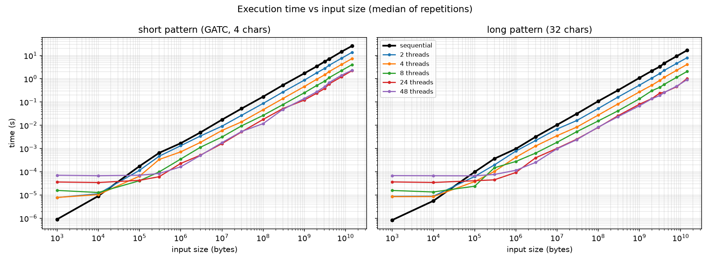
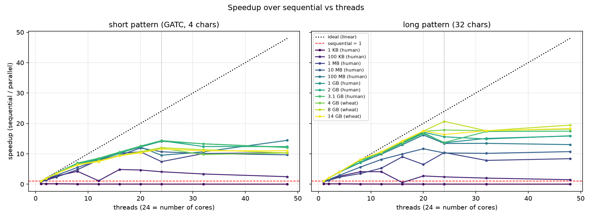
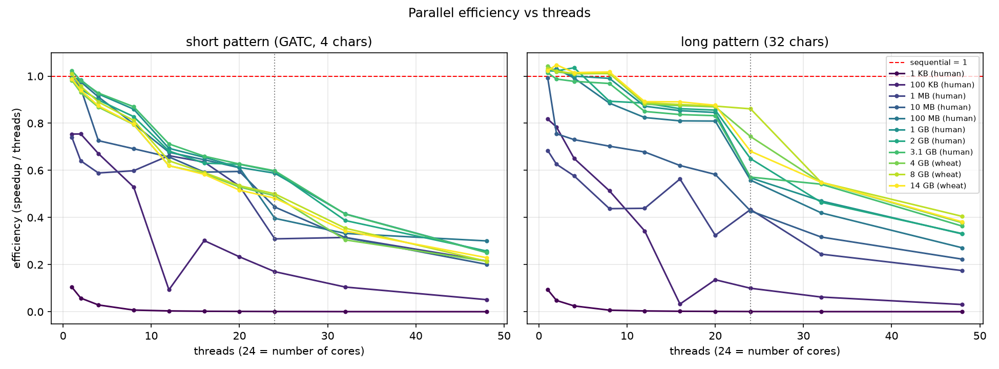
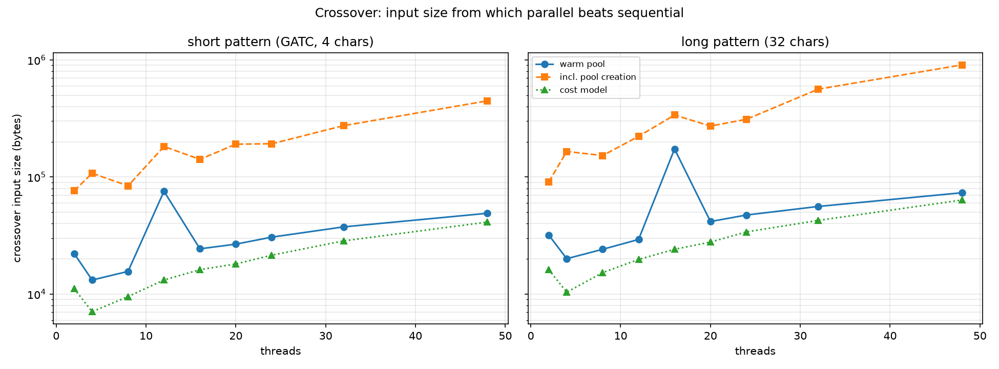
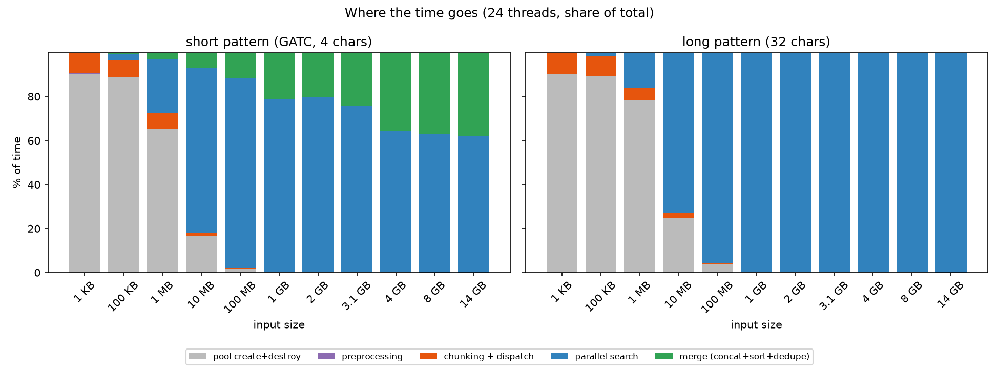
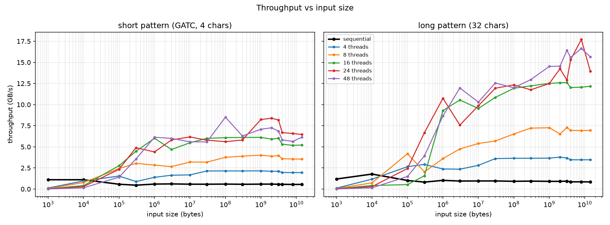
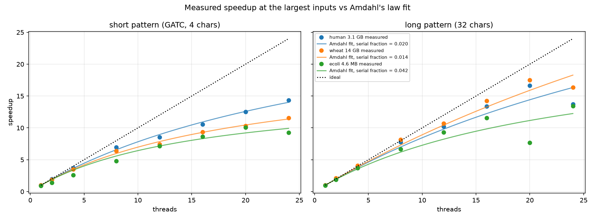
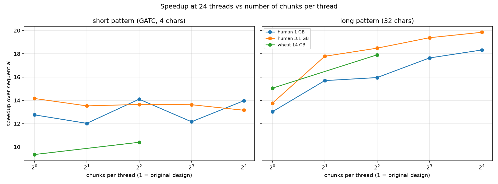

# Multi-threaded Boyer-Moore String Matching: When Does Parallelism Pay Off?

*Operating Systems project: design and analysis of a multi-threaded algorithm*

## 1. Objective

Splitting a computation across threads should make it faster, but threads are not free. Before any useful work happens, the program has to create threads, hand each one a piece of the problem, wake it up, wait for it and combine the partial results. For a small problem this overhead can cost more than the work itself, so the "parallel" version is slower than the plain sequential one. For a large problem the overhead is spread over a lot of work and the parallel version wins.

This report measures where that boundary lies for one algorithm, **Boyer-Moore exact string matching**, run on DNA sequences from 1 KB up to 14.3 GB. It answers four questions:

1. How much faster is the multi-threaded version, as a function of input size and thread count?
2. Below what input size does threading overhead make the parallel version *slower* (the **crossover point**)?
3. Which parts of the overhead dominate (thread creation, dispatch, merging)?
4. Why does the speedup stop growing even when there is plenty of work?

The parallelism used is **data parallelism**: every thread runs the same algorithm on a different part of the text. (Task parallelism, where threads run *different* steps, would fit poorly here because Boyer-Moore has only one significant step, the scan.)

## 2. The algorithm: Boyer-Moore

Boyer-Moore compares the pattern against the text **from right to left**, and when a mismatch happens it uses two precomputed tables to shift the pattern forward as far as is safe:

- **Bad-character rule:** if text character `c` mismatches, shift the pattern so that the last occurrence of `c` in the pattern lines up with it (or past it, if `c` does not occur in the pattern).
- **Good-suffix rule:** if the last `k` characters matched before the mismatch, shift the pattern so that another occurrence of that suffix (or a matching prefix) lines up.

The shift is the larger of the two. Both tables depend only on the pattern (`bm::buildBadCharTable`, `bm::buildGoodSuffixTable` in `src/boyer_moore.cpp`), so they are built once and shared read-only by every thread.

**Complexity.** With text length *n* and pattern length *m*:

| | Cost |
|---|---|
| Preprocessing | O(m + σ), σ = alphabet size (256 table entries) |
| Best case | about n / m character comparisons (whole pattern skipped each time) |
| Worst case (this implementation) | O(n · m) |
| Memory | O(m + σ) plus the list of matches |

The benefit of skipping depends on the alphabet. On English text a mismatching character is usually absent from the pattern and the pattern jumps by nearly *m*. DNA has only four letters (A, C, G, T), so almost every character appears in the pattern and the bad-character shifts are short. On DNA, Boyer-Moore therefore inspects a large share of the text, and the 32-character pattern is only about 1.6× faster than the 4-character one (section 6), even though in theory it could skip up to 8 times as far.

## 3. Parallel design

The implementation is in `src/parallel_bm.cpp` (`bm::searchParallel`) and is shared by the command-line tool (`bm_search`) and the benchmark (`bm_bench`), so the code that is measured is the code that is shipped.

```
            text (n bytes)
 ┌──────────────┬──────────────┬──────────────┬──────────────┐
 │   chunk 0    │   chunk 1    │   chunk 2    │   chunk 3    │
 └──────────────┴──────────────┴──────────────┴──────────────┘
          └ +m-1 ┘       └ +m-1 ┘       └ +m-1 ┘     (overlap)
      thread 0       thread 1       thread 2       thread 3
          \             |              |             /
           └──────── merge: concatenate, sort, dedupe ┘
```

1. **Preprocessing (sequential).** Build the bad-character and good-suffix tables once.
2. **Chunking.** Split the text into *p* equal chunks, one per thread. Each chunk is extended by *m − 1* characters into the next one. (`searchParallel` can also cut more chunks than threads; section 7.3 shows why that helps.)
3. **Dispatch.** Enqueue one task per chunk on a **thread pool** (`include/thread_pool.h`): a fixed set of worker threads that wait on a condition variable and take tasks from a mutex-protected queue. Each `enqueue` wraps the task in a `std::packaged_task`, allocates it on the heap, locks the queue and wakes one worker.
4. **Parallel search.** Each worker runs ordinary Boyer-Moore on its chunk (`bm::searchChunk`) and returns a local list of match positions. Workers share only read-only data (text, pattern, tables), so the search needs **no locks**.
5. **Merge (sequential).** The main thread waits for every future, concatenates the local lists, sorts them and removes duplicates.

**Why the overlap is correct.** A match starting at position *s* occupies characters *s … s + m − 1*. If *s* is in chunk *i* but the match runs past the end of the chunk, the extra *m − 1* characters guarantee that chunk *i* still sees all of it. Conversely, chunk *i* can only report a match whose last character lies within its extended range, so it never reports a match that *starts* in chunk *i + 1*. Every match is therefore found **exactly once**. Every parallel result in the benchmark is compared element-by-element with the sequential result, and all of them agree (section 5).

One consequence: since the chunks' match ranges are disjoint and each local list is already in order, the `sort` + `unique` step in the merge is not needed for correctness. It is kept because it is part of the original design, and its cost is measured separately (section 7.3).

## 4. Cost model

The time of one parallel search on *p* threads can be written as

```
T_parallel(n, p) =  T_pre(m)                 preprocessing: sequential, tiny
                  + T_pool(p)                creating p threads (paid once per pool)
                  + T_dispatch(p)            p enqueues + wake-ups: grows with p
                  + (n + (p-1)(m-1)) / (p·r) the actual scan, shared by p threads
                  + T_merge(k)               k = number of matches: sequential
```

where *r* is the scan rate of one thread (bytes per second). The sequential version is simply `T_seq(n) = T_pre(m) + n / r`.

From this model:

- **Small n:** the scan term is tiny, so `T_parallel ≈ T_pool + T_dispatch`, which *grows* with *p*. More threads make it slower.
- **Large n:** the scan term dominates and the speedup approaches *p*, as long as the scan rate *r* really stays constant per thread.
- **Crossover:** parallel wins when `n/r − n/(p·r) > overheads`, i.e.
  `n_crossover ≈ r · (T_dispatch(p) + T_merge) · p / (p − 1)`.
  Overheads of tens of microseconds and a scan rate of around 1 GB/s put the crossover in the **tens to hundreds of kilobytes**. If thread creation is included (no reused pool), the overhead rises to hundreds of microseconds and the crossover moves up by roughly ten times.
- **Amdahl's law:** if a fraction *f* of the work is sequential (preprocessing, dispatch, merge), the speedup is limited to `S(p) = 1 / (f + (1 − f)/p) ≤ 1/f`. The merge grows with the number of matches, so a pattern with many matches has a larger *f*.

The model assumes that every thread scans at the same rate *r*, no matter how many threads run. Section 7 shows that this is the assumption that breaks on this hardware: the cores are not all equally fast, and they slow down when more of them are busy.

## 5. Experimental setup

| | |
|---|---|
| CPU | Intel Core Ultra 9 285: 24 cores, **no hyper-threading**, hybrid: **8 performance cores** (up to 5.4–5.6 GHz) + **16 efficiency cores** (up to 4.7 GHz) |
| Caches | L2 40 MiB total, **L3 36 MiB** shared |
| Memory | 125 GB |
| OS / compiler | Linux 6.17, GCC 13.3, `-O3 -DNDEBUG` (CMake Release), C++17 |
| Thread counts | 1, 2, 4, 8, 12, 16, 20, 24, and 32, 48 (more threads than cores) |
| Patterns | short: `GATC` (4 characters, many matches); long: `ACGTTGCATGCAGTCAGTACGATCGATCGTAG` (32 characters, no matches in any dataset) |

**Datasets** (all from NCBI):

| Dataset | Raw file | Sequence used |
|---|---|---|
| *E. coli* K-12 MG1655 | 4.7 MB | 4.6 MB |
| Human GRCh38.p14 | 3.34 GB | 3.14 GB |
| Wheat IWGSC CS RefSeq v2.1 | 14.76 GB | 14.31 GB |

The benchmark keeps only the nucleotide sequence: FASTA header lines, line breaks and unknown bases (`N`) are removed, and soft-masked (lowercase) bases are upper-cased. Without this, small prefixes of the human genome would contain nothing but `N` (chromosome 1 starts with 10,000 of them), and lowercase matches would be missed. (The original `bm_search` tool searches the raw file and therefore misses lowercase matches; this does not affect the timing analysis.)

**Input sizes** are prefixes of each sequence: 1 KB, 10 KB, 100 KB, 300 KB, 1 MB, 3 MB, 10 MB, 30 MB, 100 MB, 300 MB, 1 GB, 2 GB, 4 GB, 8 GB and the full sequence. The plots use the human genome up to 3.14 GB and the wheat genome above that. Each dataset is loaded once and prefixes are views into the same buffer, so no time is spent copying.

**Methodology** (`src/benchmark.cpp`):

- Each configuration gets one warm-up run, then is repeated (50 times up to 1 MB, 10 up to 100 MB, 5 up to 1 GB, 3 above). The **median** is reported, with the minimum and maximum kept in the CSV.
- **Sequential baseline:** `bm::searchSequential`, with no thread pool at all.
- **Parallel:** `bm::searchParallel` on a thread pool created *before* timing starts, as `bm_search` does. Thread creation is measured separately (creating and destroying a pool of *p* threads, median of 20), so results can be shown both with a warm pool and including pool creation.
- **Phase timings** inside `searchParallel`: preprocessing, chunking + dispatch, waiting for all threads (the search), and merge (with its sort/dedupe part).
- **Correctness:** every parallel result is compared with the sequential result, position by position. All 770 measurements in the main sweep (and all follow-up experiments) agree with the sequential result.
- Raw data: `results/bm_results.csv`. Plots and the tables quoted below: `results/plots/`, `results/summary.md`, generated by `scripts/plot_results.py`.

## 6. Results

All numbers below are medians from `results/summary.md`. "Speedup" is sequential time ÷ parallel time; below 1 means the parallel version is slower.

### 6.1 Execution time vs input size



The sequential time (black) is a straight line: Boyer-Moore's cost grows linearly with the input. One thread scans about **0.58 GB/s** with the short pattern and **0.92 GB/s** with the long one, from 1 MB all the way to 14.3 GB (25.6 s for the whole wheat genome).

The parallel lines are **flat at small sizes**. Below about 100 KB they no longer depend on the input at all, because they are pure overhead: 8 µs with 2 threads, 36 µs with 24 and 70 µs with 48. More threads means *more* fixed overhead, which is why the lines are stacked in reverse order on the left of the plot. Each parallel line crosses the sequential line somewhere between 10 KB and 100 KB, and from then on it runs parallel to it, at a constant factor below.

| Input | Sequential | 2 threads | 24 threads | 48 threads |
|---|---|---|---|---|
| 1 KB (short pattern) | 0.9 µs | 7.8 µs (8.6× slower) | 36 µs (**40× slower**) | 71 µs (78× slower) |
| 10 KB | 9.1 µs | 11 µs | 34 µs | 68 µs |
| 100 KB | 174 µs | 115 µs | 43 µs (**4.1× faster**) | 71 µs |
| 1 GB | 1.71 s | 0.87 s | 0.121 s (**14.1× faster**) | 0.141 s |

Even running the parallel code on **one thread** shows the cost of the machinery. It is 9.6× slower than the plain sequential search at 1 KB and 1.8× slower at 10 KB, but within ±4% of it from 10 MB upwards.

### 6.2 Speedup and efficiency vs threads



| Input | Short pattern: speedup @24 (best) | Long pattern: speedup @24 (best) |
|---|---|---|
| 1 KB | 0.02 (0.12 with 2 threads) | 0.02 (0.10 with 4 threads) |
| 100 KB | 4.1 (4.8 with 16) | 2.4 (4.1 with 12) |
| 1 MB | 7.4 (10.7 with 20) | 10.4 |
| 100 MB | 9.5 (14.4 with 48) | 13.4 (16.2 with 20) |
| 1 GB | **14.1** | 13.6 (16.9 with 20) |
| 3.1 GB (human, full) | **14.4** | 13.7 (17.5 with 48) |
| 8 GB (wheat) | 12.0 | **20.7** |
| 14.3 GB (wheat, full) | 11.6 | 16.4 (18.3 with 48) |



Three patterns stand out:

1. **The best number of threads grows with the input.** At 1 KB it is 2–4 threads, at 100 KB 12–16, and from 1 GB upwards 20–48. Using all cores on a small input is the worst choice.
2. **Speedup levels off at 14–20× on 24 cores.** Efficiency (speedup ÷ threads) at 24 threads never exceeds 0.60 for the short pattern or 0.86 for the long one. The scaling is nearly linear up to 8 threads and then bends; section 7.2 explains why.
3. **For the short pattern, the largest inputs scale *worse*.** Speedup falls from 14.4× on the 3.1 GB human genome to 11.6× on the 14.3 GB wheat genome. Section 6.5 explains this.

### 6.3 The crossover point



The crossover is the input size from which the parallel version stays faster, interpolated between measured sizes:

| Threads | Short pattern: warm pool | Short: incl. pool creation | Long pattern: warm pool | Long: incl. pool creation | Cost model (short / long) |
|---|---|---|---|---|---|
| 2 | 22 KB | 76 KB | 32 KB | 91 KB | 11 / 16 KB |
| 4 | 13 KB | 108 KB | 20 KB | 165 KB | 7 / 10 KB |
| 8 | 16 KB | 84 KB | 24 KB | 152 KB | 10 / 15 KB |
| 24 | 31 KB | 192 KB | 47 KB | 311 KB | 21 / 34 KB |
| 48 | 49 KB | 447 KB | 73 KB | 907 KB | 41 / 64 KB |

- **With a reused thread pool, parallelism pays off from roughly 15–75 KB.** That is only a few milliseconds of work for one core.
- **If the threads have to be created for each search, the crossover moves up 3–12×, to about 75–900 KB.** Creating and destroying 24 threads costs 0.35 ms, and 48 threads cost 0.86 ms (section 6.4).
- From 4 threads upwards, the crossover rises with the thread count, as the cost model predicts: every extra thread adds dispatch overhead but saves less and less scan time. With 2 threads it is higher than with 4, because 2 threads save only half of the scan time.
- The **cost model from section 4** predicts every measured crossover within a factor of about 2. It always errs low, because it assumes the scan speeds up perfectly, which it doesn't (section 7.2). Two points in the full table in `results/summary.md` (12 threads with the short pattern, 16 with the long one) jump higher because of a single noisy mid-size measurement.

### 6.4 Where the time goes



The bars split one 24-thread search into phases. The grey part is the one-time cost of creating the pool, shown for comparison.

| Phase (24 threads) | Cost | Grows with |
|---|---|---|
| Thread pool create + destroy | 0.35 ms (≈15 µs per thread) | threads |
| Preprocessing (tables) | ≈0.2–1 µs | pattern length (negligible) |
| Chunking + dispatch | 25–50 µs (≈1–2 µs per task) | threads |
| Parallel search | n / (aggregate scan rate) | input size |
| Merge (concatenate, sort, dedupe) | 0.025 s at 1 GB → 0.84 s at 14.3 GB (short pattern) | number of matches |

- **Up to about 100 KB**, pool creation and dispatch make up over 90% of the time.
- **From 10 MB**, the parallel search is most of the time. Dispatch falls below 2%, and creating the pool (if it had to be paid for each search) would be under 2% from 100 MB.
- **The merge is the only overhead that grows with the input**, because it grows with the number of matches. The short pattern matches about once every 240–420 bases. It accounts for 21% of the time at 1 GB, 24% at 3.1 GB and **38% at 14.3 GB** (60 million matches). The long pattern has no matches, so its merge costs nothing.

### 6.5 Very large inputs: 3.1 GB vs 14.3 GB



The sequential throughput is the same for both genomes (0.56–0.58 GB/s), so the extra size changes nothing for one thread. The parallel versions differ:

- **Long pattern (no merge):** speedup is as good or better on the bigger genome: 13.7× at 3.1 GB, 20.7× at 8 GB and 16.4× at 14.3 GB. More data means each thread's chunk is longer, and relative noise is smaller.
- **Short pattern:** speedup *drops* from 14.4× to 11.6×. The parallel search part still scales, but the sequential merge grows with the 60 million matches, to 0.84 s of the 2.22 s total. This is **Amdahl's law in practice**: the larger the problem, the more matches, and the larger the sequential share.



Fitting Amdahl's law to the speedups at the largest inputs (1–24 threads) gives a sequential fraction of **3.1%** on human and **4.8%** on wheat for the short pattern, and **2.0%** and **1.4%** for the long one.

- For the **short pattern**, the curve fits well all the way to 24 threads. A sequential share of 3–5% is enough to describe its scaling, though the fitted number lumps together the merge and the core imbalance of section 7.2.
- For the **long pattern**, the measurements are close to ideal up to 20 threads and then *drop* at 24. Amdahl's law cannot produce a drop like that. It is the load-imbalance effect explained in section 7.2.

## 7. Analysis

### 7.1 Small vs large problems

The experiments confirm the trade-off described in section 1 and put numbers on it:

- **Small problems (under ~10–50 KB): overhead dominates.** Handing out 24 tasks costs about 35 µs, while the whole sequential search of 1 KB takes 0.9 µs. Nothing the threads do can win back a fixed cost that is 40 times the total work. Here the sequential algorithm is the right choice.
- **Medium problems (~50 KB – 10 MB): parallelism pays off, but only partially.** The speedup climbs from 1× to about 10×, and fewer threads are often better than more.
- **Large problems (over ~100 MB): the algorithm wins.** Dispatch is under 1% of the time and the speedup reaches 14–20×. The limit is now the hardware and the sequential merge, not the threading machinery.

### 7.2 Why the speedup stops at 14–20× on 24 cores

**Memory bandwidth is not the limit.** A simple parallel read of a 4 GB array (`src/membw.cpp`, `results/membw.csv`) reaches **61 GB/s** on this machine. Even the fastest Boyer-Moore run uses only 11–19 GB/s. Boyer-Moore does enough work per byte that it is limited by the processor, not by memory.

**The cores are not equally fast.** The Core Ultra 9 285 has 8 performance cores and 16 efficiency cores. Pinning the search to one core type with `taskset` (`scripts/run_experiments.sh`) shows:

| | Performance core | Efficiency core | Ratio |
|---|---|---|---|
| 1 GB, short pattern, 1 thread | 1.70 s | 2.23 s | P is 1.31× faster |
| 1 GB, long pattern, 1 thread | 1.06 s | 1.26 s | P is 1.19× faster |
| Clock with 1 core busy | 5.6 GHz | 4.6 GHz | |
| Clock with 8 / 16 / all 24 busy | 5.3 / – / 4.9 GHz | 4.6 GHz | |

The sequential baseline usually runs on a performance core at full clock. The parallel version gives every thread an **equal-sized chunk**, so it can only finish when the slowest core, an efficiency core, finishes its chunk. Performance cores sit idle at the end. In addition, the performance cores slow down from 5.6 to 4.9 GHz when all cores are busy.

This simple estimate matches the short-pattern measurement closely. For 1 GB:

- 24 equal chunks on efficiency cores take 2.23 s ÷ 24 = 0.093 s;
- add the 0.025 s sequential merge to get **0.118 s**;
- that predicts a speedup of 1.70 ÷ 0.118 = **14.4×**. The measured value is **12.8–14.1×**.

For the long pattern, the same calculation predicts 20.2×, but the original design reaches only 13–14×. With all 24 cores busy, any other activity on the machine (the OS, background processes) that delays a single thread delays the whole search, because nothing else can take over its chunk. This is also why 20 threads often beat 24 in the speedup plot, and why 48 threads sometimes beat 24: with more threads than cores, the OS keeps moving threads around, which happens to balance the load.

Not everything is explained:

- On 8 performance cores alone, the speedup is 6.5× rather than 8×. The clock drop (5.6 → 5.3 GHz) accounts for only about 5% of that.
- On 16 efficiency cores alone, the long pattern scales almost perfectly (15.6×), but the short pattern reaches only 9.6×.

So the short pattern also loses efficiency for another reason. One plausible cause is that each thread writes millions of match positions into a growing list, which costs extra memory allocation and copying, but this was not isolated.

### 7.3 A design improvement suggested by the analysis

If uneven chunk times are the problem, the fix is to make chunks **smaller than one per thread**. The text is split into *k* chunks per thread and all of them are put on the pool's queue. A fast core that finishes early simply takes the next chunk, so the work balances itself. This is dynamic load balancing, and it needs only one extra parameter (`tasks_per_thread` in `bm::searchParallel`).



| Long pattern, 24 threads | 1 chunk/thread (original) | 2 | 4 | 8 | 16 |
|---|---|---|---|---|---|
| human 1 GB | 13.0× | 15.7× | 16.0× | 17.6× | **18.3×** |
| human 3.1 GB | 13.8× | 17.8× | 18.5× | 19.4× | **19.8×** |
| wheat 14.3 GB | 15.0× | – | **17.9×** | – | – |

With perfect load balancing, the best possible speedup is the total speed of all cores together compared with one performance core:

- 8 performance cores running at 4.9/5.6 of their single-core speed (the clock measured with all cores busy), plus 16 efficiency cores at their own speed, scan about 19.3 GB/s with the long pattern;
- one performance core scans 0.94 GB/s;
- so the ceiling is about **20.4×**.

With 16 chunks per thread, the search reaches **19.8×, about 97% of that ceiling**. The cost is negligible: 384 tasks instead of 24 raise dispatch from 0.06 ms to 0.11 ms at 3.1 GB, under 0.1% of the time.

For the **short pattern** the same change does not help (12–14× with any number of chunks), and the analysis says why. Its balanced ceiling is only about 15×, because the efficiency cores are relatively slower on it and the sequential merge already takes 20–40% of the time. There, the merge is the part to improve. The overlap argument in section 3 shows that the chunks' results are already disjoint and in order, so the `sort` + `unique` step could be dropped. From the measured sort time, that would save about 0.49 s of the 2.22 s at 14.3 GB, an estimated 14.8× instead of 11.6×. Concatenating the partial results in parallel would cut the merge further. Both are left as future work.

### 7.4 More threads than cores (32 and 48)

Oversubscribing the 24 cores:

- **Small inputs get worse:** the warm-pool crossover rises from 31 KB (24 threads) to 49 KB (48 threads), and to 447 KB if pool creation is included. Creating 48 threads costs 0.86 ms.
- **Large inputs: no reliable gain.** 48 threads were sometimes the best (17.5× vs 13.7× for the long pattern on 3.1 GB) because the OS then balances the load. But they were sometimes worse (short pattern on 3.1 GB: 12.0× vs 14.4×). Splitting into more chunks (section 7.3) gets the same balancing benefit without the extra threads, more reliably.

### 7.5 Short vs long pattern

| | Short (`GATC`) | Long (32 chars) |
|---|---|---|
| Sequential speed | 0.58 GB/s | 0.92 GB/s |
| Matches in 1 GB | ~2.4 million | 0 |
| Crossover (24 threads, warm pool) | 31 KB | 47 KB |
| Best speedup | 14.4× | 20.7× |
| Amdahl sequential fraction | 3.1–4.8% | 1.4–2.0% |

The long pattern is faster per byte, so a parallel run needs a bit *more* input before the fixed overhead pays off (higher crossover). But it scales better at large sizes, because without matches there is almost nothing to merge sequentially. On DNA, the 8× longer pattern gives only a 1.6× faster sequential search, because with four letters almost every character appears in the pattern (section 2).

### 7.6 Measurement noise

Medians over repeated runs remove most noise, but some remains when all cores are busy. The same configuration measured in two separate runs (wheat, short pattern, 24 threads) took 2.22 s in the main sweep and 2.65 s in the follow-up experiment. A few mid-sized points (for example 100 MB with 24 threads) fall below their neighbours in the speedup plot. Conclusions in this report rely on trends across many sizes and thread counts, not on any single point.

## 8. Comparison with the other algorithms in the project

For context only: one run of each algorithm in `bm_search` on the raw 3.3 GB human genome file (pattern `GATTACAGATTACA`, 14 characters; output in `results/other_algorithms.txt`). These are single runs, not medians, and they use the same equal-chunk design as Boyer-Moore.

| Algorithm | 1 thread | 24 threads | Speedup |
|---|---|---|---|
| Boyer-Moore | 2.39 s | 0.208 s | 11.5× |
| Fuzzy Bitap (≤1 error) | 3.26 s | 0.234 s | 13.9× |
| AVX2 SIMD | 1.02 s | **0.084 s** | 12.1× |
| Aho-Corasick (3 patterns) | 6.10 s | 0.412 s | 14.8× |
| CUDA (RTX 4000 Ada) | 0.29 s (includes copying the text to the GPU) | – | – |

All CPU algorithms reach a similar 11–15× on 24 threads, which fits the hybrid-core explanation in section 7.2. The ones that do more work per byte (Aho-Corasick, fuzzy matching) scale slightly better, since the fixed overheads are a smaller share of their time. SIMD is the fastest in absolute terms. The GPU time includes allocating GPU memory and copying 3.3 GB to the card; this was not measured separately, but it is likely most of the 0.29 s.

## 9. Conclusions

1. **Parallelism has a minimum useful problem size.** For multi-threaded Boyer-Moore on this machine, that size is about **15–75 KB** with a reused thread pool and **75–900 KB** if threads are created per search. Below it, the parallel version is slower, up to **40×** slower at 1 KB with 24 threads.
2. **The fixed overhead is easy to predict.** About 15 µs per thread to create, and 1–2 µs per task to hand out work. A simple cost model (section 4) predicts the crossover within a factor of 2.
3. **For large inputs, the algorithm wins: 14× (short pattern) to 20× (long pattern) on 24 cores.** From about 100 MB, handing out work costs under 1% of the time, and even creating the threads costs under 2%.
4. **The limits at large sizes are**:
   - the **sequential part**: merging millions of matches. Amdahl's law shows up directly, as speedup falls from 14.4× to 11.6× when the input grows from 3.1 GB to 14.3 GB.
   - **unequal cores with equal chunks**: hybrid performance and efficiency cores. Memory bandwidth is *not* a limit.
5. **The analysis points to the fix:** splitting the work into more chunks than threads raised the long-pattern speedup from 13.8× to 19.8×, about 97% of what this CPU can deliver.
6. **Practical rule:** choose the number of threads based on the input size. Run sequentially below a few tens of KB, use a few threads up to about 1 MB, and use all cores, with several chunks per thread, above that. Always reuse threads.

## 10. Reproducing the results

| File | Purpose |
|---|---|
| `src/parallel_bm.cpp` | Parallel Boyer-Moore with per-phase timing (used by `bm_search` and `bm_bench`) |
| `src/benchmark.cpp` | `bm_bench`: the sweep that produced `results/bm_results.csv` |
| `scripts/run_experiments.sh` | Follow-up experiments: core types, chunk sizes, memory bandwidth, clock (`results/experiments.csv`, `membw.csv`, `frequency.csv`) |
| `src/membw.cpp` | Memory-bandwidth probe |
| `scripts/plot_results.py` | All plots in `results/plots/` and the tables in `results/summary.md` |

```bash
cmake -S . -B build && cmake --build build
build/bm_bench datasets/ecoli_genome.fna results/bm_results.csv --name ecoli
build/bm_bench datasets/human_genome.fna results/bm_results.csv --name human
build/bm_bench datasets/wheat_genome.fna results/bm_results.csv --name wheat   # ~21 minutes
scripts/run_experiments.sh build
.venv/bin/python scripts/plot_results.py results/bm_results.csv results/plots
```

Running the full sweep takes about 30 minutes and needs about 30 GB of RAM. The core numbering in `run_experiments.sh` is specific to the Core Ultra 9 285.
